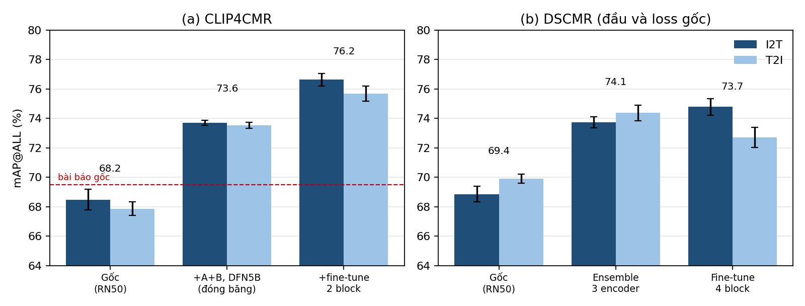
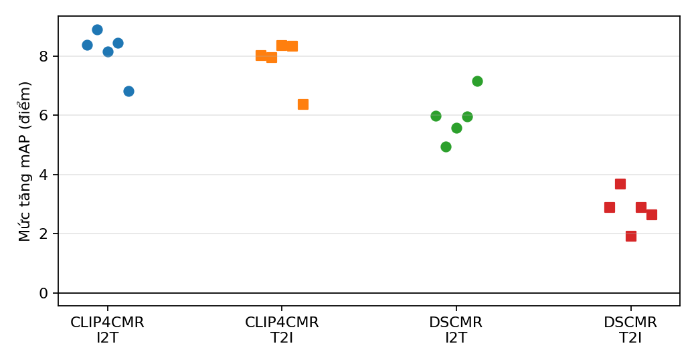
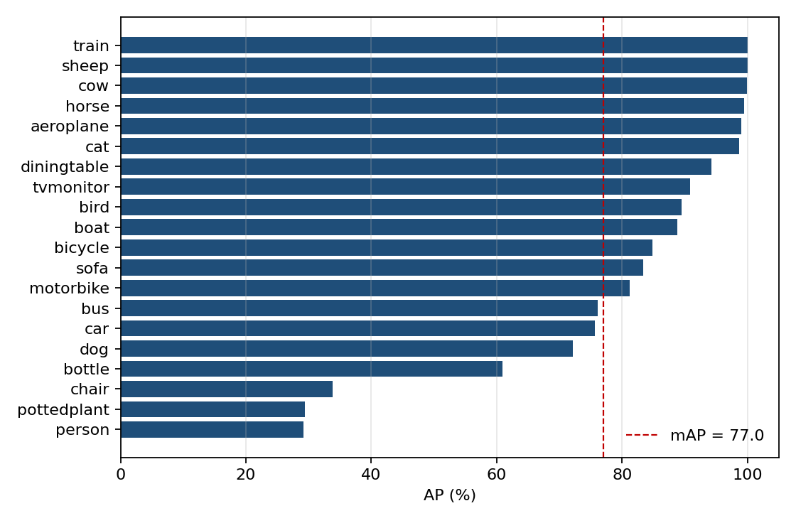

# Cải tiến DSCMR và CLIP4CMR cho truy hồi ảnh – văn bản trên Pascal Sentence

Đồ án tái lập và cải tiến hai phương pháp truy hồi đa phương thức có giám sát:
**DSCMR** (Zhen et al., CVPR 2019) và **CLIP4CMR** (Zeng & Mao, 2022).
Mọi cấu hình được chọn bằng kiểm định chéo trên tập train; tập test chỉ được mở một lần.

**Nhóm thực hiện (Đại học FPT Đà Nẵng):** Vũ Quốc Đạt · Mai Quốc Huy · Nguyễn Gia Phúc · Ngô Ngọc Trường Sơn · Trần Đăng Khoa

**Bài báo (định dạng IEEE, 6 trang):** [paper/ieee_latex/DSCMR_CLIP4CMR_IEEE.pdf](paper/ieee_latex/DSCMR_CLIP4CMR_IEEE.pdf) · mã nguồn LaTeX [paper/ieee_latex/DSCMR_CLIP4CMR_IEEE.tex](paper/ieee_latex/DSCMR_CLIP4CMR_IEEE.tex)

**Notebook kết quả (chạy được ngay, không cần GPU):** [notebooks/results_and_verification.ipynb](notebooks/results_and_verification.ipynb)

**Trọng số đã huấn luyện (5 seed):** [GitHub Releases `weights-v1`](https://github.com/sotbatchien123/dscmr-clip4cmr-pascal/releases/tag/weights-v1)

---

## Mục lục

1. [Kết quả chính](#1-kết-quả-chính)
2. [Cấu trúc thư mục](#2-cấu-trúc-thư-mục)
3. [Cài đặt môi trường](#3-cài-đặt-môi-trường)
4. [Chuẩn bị dữ liệu](#4-chuẩn-bị-dữ-liệu)
5. [Tái lập từng thí nghiệm](#5-tái-lập-từng-thí-nghiệm)
6. [Kiểm chứng kết quả, notebook và trọng số](#6-kiểm-chứng-kết-quả-notebook-và-trọng-số)
7. [Giao thức đánh giá](#7-giao-thức-đánh-giá)
8. [Phiên bản mã nguồn và lưu ý tái lập](#8-phiên-bản-mã-nguồn-và-lưu-ý-tái-lập)
9. [Biên dịch bài báo](#9-biên-dịch-bài-báo)
10. [License](#10-license)

---

## 1. Kết quả chính

mAP@ALL (%) trên tập test 200 cặp, trung bình 5 seed (42–46).

| Mô hình | Gốc I2T / T2I | Cải tiến I2T / T2I | Tăng (TB 2 chiều) |
|---|---|---|---|
| CLIP4CMR (split tác giả) | 68.48 / 67.87 | **76.63 / 75.68** | **+7.98**, tăng ở 5/5 seed cả hai chiều |
| DSCMR, giữ nguyên đầu và loss gốc (split CLIP4CMR) | 68.86 / 69.89 | **74.78 / 72.70** | **+4.36**, tăng ở 5/5 seed |

Đóng góp của từng cải tiến cho CLIP4CMR (test, TB 2 chiều):

| Bước | mAP | Tăng thêm |
|---|---|---|
| CLIP4CMR gốc (RN50) | 68.17 | – |
| + A: prototype ngữ nghĩa + adapter phần dư, B: huấn luyện theo từng câu mô tả | 70.76 | +2.59 |
| + C: encoder DFN5B ViT-H/14 (đóng băng) | 73.62 | +2.86 |
| + D: fine-tune 2 block cuối của nhánh ảnh | **76.15** | +2.53 |



*Trung bình 5 seed, thanh sai số là độ lệch chuẩn mẫu. Đường đứt nét là số công bố của bài báo CLIP4CMR gốc. Hình được vẽ lại bởi notebook.*

- **Đối chứng:** adapter với prototype ngẫu nhiên (A_res) không cải thiện (+0.24), nên phần tăng của A đến từ prototype ngữ nghĩa.
- **DSCMR:** thay loss không gian chung bằng SupCon chỉ tăng chiều I2T (+1.15, 5/5 seed), không tăng T2I. Đây là kết quả âm tính và được báo cáo đầy đủ.
- **So với bài báo gốc:** CLIP4CMR cải tiến cao hơn số công bố (69.8 / 69.2) khoảng 6.5 điểm, dù dùng giao thức chặt hơn (chọn checkpoint trên validation thay vì trên test).

---

## 2. Cấu trúc thư mục

```
.
├── README.md                  hướng dẫn này
├── requirements.txt           thư viện Python
├── LICENSE                    MIT cho mã và tài liệu của nhóm
├── THIRD_PARTY_NOTICES.md     điều khoản của mã, mô hình, dữ liệu bên thứ ba
│
├── common/                    hàm dùng chung
│   └── metrics.py             mAP@ALL, Recall@K, độ liên quan theo nhãn
├── tests/
│   └── test_metrics.py        kiểm thử đơn vị cho metrics
│
├── scripts/                   toàn bộ thí nghiệm, chạy bằng  python -m scripts.<nhóm>.<tên>
│   ├── data/                  1. tải mã gốc, dựng dữ liệu, trích đặc trưng
│   ├── baseline/              2. tái lập DSCMR và CLIP4CMR gốc
│   ├── dscmr/                 3. cải tiến loss cho DSCMR (SupCon, trọng số thích nghi)
│   ├── clip4cmr/              4. cải tiến A + B cho CLIP4CMR
│   ├── encoders/              5. encoder mạnh hơn và fine-tune nhánh ảnh (cho cả hai mô hình)
│   └── analysis/              phân tích phụ: probe đặc trưng, thử khôi phục ID ảnh của DSCMR
│
├── reports/                   kết quả đã chạy (JSON, CSV, log, hình) và báo cáo từng vòng
├── notebooks/                 notebook kết quả + kiểm chứng (đã có sẵn output)
├── assets/                    hình do notebook sinh ra, dùng trong README
├── paper/ieee_latex/          bài báo IEEE: mã nguồn LaTeX, hình và bản PDF
│
├── DSCMR/                     source.json (nguồn mã gốc), data_ids/NOTE.md; mã gốc tải vào DSCMR/upstream/
└── CLIP4CMR/                  source.json; mã gốc tải vào CLIP4CMR/upstream/, dữ liệu vào CLIP4CMR/data/
```

### Danh sách script

| Nhóm | Script | Chức năng |
|---|---|---|
| data | `fetch_upstream` | Tải mã gốc DSCMR và CLIP4CMR (kèm đặc trưng Pascal của DSCMR) vào `*/upstream/` |
| data | `build_pascal_local` | Tải 1.000 ảnh và câu mô tả Pascal Sentence từ UIUC, dựng split cục bộ 800/200 |
| data | `audit_pascal_sources` | Ghi bằng chứng nguồn dữ liệu (checksum, số câu mô tả mỗi ảnh) |
| data | `build_multicaption` | Trích đặc trưng CLIP RN50 / ViT-L/14: ảnh, từng câu mô tả, câu nhắc theo lớp |
| data | `verify_hf_mirror` | Kiểm chứng bản sao split tác giả CLIP4CMR với đặc trưng tự trích |
| data | `probe_mirror_text_rule` | Tìm quy tắc xử lý văn bản khớp với bản sao |
| data | `build_author_split` | Dựng dữ liệu theo split tác giả CLIP4CMR |
| data | `extract_encoders` | Trích đặc trưng 4 encoder lớn (ViT-L/14-336, EVA02-L, SigLIP, DFN5B) |
| baseline | `train_baseline` | Huấn luyện DSCMR / CLIP4CMR gốc trên đặc trưng cố định |
| baseline | `report_5000_1000` | Kiểm tra và tổng hợp lượt baseline dài (5.000 + 1.000 epoch) |
| baseline | `clip4cmr_paper_protocol` | CLIP4CMR theo đúng cách chọn checkpoint của bài báo (so sánh với số công bố) |
| baseline | `dscmr_author_protocol` | DSCMR theo đúng mã gốc (so sánh với số công bố) |
| dscmr | `loss_ablation` | Vòng 1: loss gốc / SupCon / trọng số thích nghi / kết hợp, 3 seed |
| dscmr | `loss_tuning` | Vòng 2: tuning hệ số loss bằng CV, xác nhận 5 seed |
| dscmr | `audit_loss_ablation` | Kiểm tra ngân sách, early stopping, checkpoint của vòng 1; vẽ hình |
| dscmr | `plot_loss_tuning` | Vẽ hình cho vòng 2 |
| dscmr | `recheck_author_eval` | Tính lại mAP test bằng evaluator của tác giả |
| dscmr | `rerank_cv` | Thử xếp hạng lại kết quả truy hồi (kết quả âm tính) |
| clip4cmr | `improve` | Cải tiến A (prototype ngữ nghĩa + adapter) và B (từng câu mô tả), đối chứng A_res |
| clip4cmr | `recheck_author_eval` | Tính lại mAP test bằng evaluator của tác giả |
| clip4cmr | `plot_improve` | Vẽ hình cho nghiên cứu A + B |
| encoders | `encoder_study` | So sánh encoder và đầu truy hồi bằng CV, xác nhận 5 seed |
| encoders | `finetune_image_tower` | Fine-tune N block cuối của nhánh ảnh DFN5B |
| analysis | `probe_label_space` | Probe tuyến tính: chẩn đoán đặc trưng ảnh là nút thắt |
| analysis | `dscmr_ids_*` | Bốn cách thử khôi phục ID ảnh trong split DSCMR (đều thất bại, xem `DSCMR/data_ids/NOTE.md`) |
| analysis | `evaluate_features` | Đánh giá độc lập một file đặc trưng đã xuất |

Mỗi script có docstring ở đầu file mô tả đầu vào, đầu ra và cách chạy.

---

## 3. Cài đặt môi trường

Đã kiểm thử trên Windows 11, Python 3.10, PyTorch 2.7.1 + CUDA 12.8, GPU RTX 5070 Laptop 8 GB.

```bash
python -m venv .venv310
.venv310\Scripts\activate          # Linux/macOS: source .venv310/bin/activate
pip install torch==2.7.1 torchvision==0.22.1 --index-url https://download.pytorch.org/whl/cu128
pip install -r requirements.txt
```

`requirements.txt` đã gồm gói OpenAI CLIP (cho RN50 và ViT-L/14).

Các script trong `scripts/encoders/` và `scripts/data/extract_encoders.py` cần thêm `open_clip_torch` và `timm` bản mới. Mã gốc của tác giả lại cần `timm` bản cũ, nên hai gói này được cài vào một thư mục riêng; script tự thêm thư mục này vào `sys.path`:

```bash
pip install --target .feat_libs open_clip_torch==2.32.0 timm==1.0.15
```

### Hai lỗi thường gặp và cách khắc phục:

1. **Lỗi chặn thực thi script khi kích hoạt môi trường ảo trên PowerShell (`running scripts is disabled on this system`):**
   - *Hiện tượng:* Khi chạy `.venv310\Scripts\activate` trên Windows PowerShell, hệ thống chặn kích hoạt do chính sách bảo mật thực thi script (`ExecutionPolicy`).
   - *Cách khắc phục:* Mở PowerShell và cấp quyền cho người dùng hiện tại:
     ```powershell
     Set-ExecutionPolicy -ExecutionPolicy RemoteSigned -Scope CurrentUser
     ```
     Hoặc kích hoạt môi trường thông qua Command Prompt (`cmd.exe`):
     ```cmd
     .venv310\Scripts\activate.bat
     ```

2. **Lỗi thiếu Git khi cài đặt thư viện (`Cannot find command 'git' - do you have 'git' installed and in your PATH?`):**
   - *Hiện tượng:* Lệnh `pip install -r requirements.txt` bị lỗi do file chứa gói `git+https://github.com/openai/CLIP.git`, đòi hỏi máy phải có công cụ Git trong PATH.
   - *Cách khắc phục:*
     - Cài đặt Git từ [git-scm.com](https://git-scm.com) (chọn thêm Git vào PATH) rồi khởi động lại terminal.
     - *Hoặc* cài đặt trực tiếp gói CLIP từ file zip qua pip mà không cần Git CLI:
       ```bash
       pip install https://github.com/openai/CLIP/archive/master.zip
       ```

**Mọi lệnh bên dưới chạy từ thư mục gốc của repo**, theo dạng `python -m scripts.<nhóm>.<tên>`.

---

## 4. Chuẩn bị dữ liệu

Mã gốc, dữ liệu, đặc trưng và trọng số không nằm trong repo (xem [THIRD_PARTY_NOTICES.md](THIRD_PARTY_NOTICES.md)). Chạy lần lượt:

```bash
# 4.1 Mã gốc DSCMR, CLIP4CMR và đặc trưng Pascal của DSCMR
python -m scripts.data.fetch_upstream

# 4.2 Ảnh + câu mô tả Pascal Sentence từ UIUC (danh sách trong reports/clip4cmr_investigation_20261014/pascal_raw_manifest.json)
python -m scripts.data.build_pascal_local
python -m scripts.data.audit_pascal_sources

# 4.3 Đặc trưng CLIP RN50 / ViT-L/14 theo từng câu mô tả
python -m scripts.data.build_multicaption
```

**4.4 Split tác giả CLIP4CMR.** Đường dẫn dữ liệu gốc của tác giả đã hết hạn. Nhóm dùng bản sao `clip_train.pkl` và `clip_test.pkl` từ Hugging Face Space `shivangibithel/LCMI_T2I` (bên thứ ba).

1. Đặt hai file vào `CLIP4CMR/data/hf_mirror_lcmi/`.
2. Chạy kiểm chứng rồi dựng split:

```bash
python -m scripts.data.verify_hf_mirror        # kiểm tra: 922/1000 ảnh trùng đặc trưng tự trích (cos > 0.999)
python -m scripts.data.probe_mirror_text_rule
python -m scripts.data.build_author_split
```

Pickle được đọc bằng unpickler chỉ cho phép kiểu numpy.

```bash
# 4.5 Đặc trưng 4 encoder lớn (cần .feat_libs, tải trọng số qua open_clip)
python -m scripts.data.extract_encoders
python -m scripts.encoders.encoder_study --stage data
```

---

## 5. Tái lập từng thí nghiệm

Bảng dưới ánh xạ từng bảng trong bài báo tới lệnh chạy và thư mục kết quả đã lưu sẵn trong repo.

| Bài báo | Lệnh | Kết quả trong repo |
|---|---|---|
| Bảng I (tái lập) | 5.1 | `reports/RESULTS_5000_1000.md`, `reports/clip4cmr_paper_protocol_20261030/`, `reports/dscmr_author_protocol_20261030/` |
| Bảng II (ablation A, B) | 5.3 | `reports/clip4cmr_author_split_20261030/` |
| Bảng III (so sánh encoder) | 5.4 | `reports/improve_v3_20261030/cv/` |
| Bảng IV, VI, Hình 1 (kết quả chính) | 5.4, 5.5 | `reports/improve_v3_20261030/confirm/`, `.../finetune/` |
| Bảng V (loss DSCMR) | 5.2 | `reports/assignment3_20261029/`, `reports/assignment3_tuning_20261030/` |

Mỗi thư mục kết quả có `protocol.json` (cấu hình, checksum dữ liệu và mã), `results.csv`, `aggregate.json` và báo cáo `BAO_CAO.md` hoặc `REPORT.md`.

Một số lưu ý khi chạy:
- Có thể chạy thử nhanh trước bằng `--stage smoke` (hoặc `check`).
- Thí nghiệm dài có thể tạm dừng bằng cách tạo file `STOP` trong thư mục `--out`; chạy lại đúng lệnh để tiếp tục.
- Không ghi đè thư mục kết quả có sẵn: script sẽ báo lỗi nếu cấu hình đổi. Hãy dùng một `--out` mới.

### 5.1 Baseline và so sánh với bài báo gốc

```bash
python -m scripts.baseline.train_baseline --method DSCMR --max-epochs 5000 --refit-epochs 1000 \
       --out DSCMR/runs/pascal_selection5000_refit1000_seed42
python -m scripts.baseline.train_baseline --method CLIP4CMR --data CLIP4CMR/data/pascal_uiuc_seed42 \
       --max-epochs 5000 --refit-epochs 1000 --out CLIP4CMR/runs/pascal_selection5000_refit1000_seed42
python -m scripts.baseline.report_5000_1000

python -m scripts.baseline.clip4cmr_paper_protocol     # chọn checkpoint theo test như mã gốc
python -m scripts.baseline.dscmr_author_protocol
```

### 5.2 DSCMR: thay loss không gian chung (Bảng V)

```bash
python -m scripts.dscmr.loss_ablation --out reports/assignment3_20261029             # vòng 1, 3 seed
python -m scripts.dscmr.audit_loss_ablation reports/assignment3_20261029
python -m scripts.dscmr.loss_tuning --out reports/assignment3_tuning_20261030        # vòng 2: CV + 5 seed
python -m scripts.dscmr.plot_loss_tuning reports/assignment3_tuning_20261030 reports/assignment3_20261029
```

### 5.3 CLIP4CMR: cải tiến A và B (Bảng II)

```bash
# split tác giả (dùng trong bài báo)
python -m scripts.clip4cmr.improve --feats CLIP4CMR/data/pascal_author_split_mirror \
       --out reports/clip4cmr_author_split_20261030
# split cục bộ UIUC (thí nghiệm phụ)
python -m scripts.clip4cmr.improve --out reports/clip4cmr_improve_20261030
python -m scripts.clip4cmr.plot_improve
```

### 5.4 Encoder mạnh hơn (Bảng III, IV, VI)

```bash
# CV 3-fold trên train cho từng encoder (có thể chia nhiều lần chạy)
python -m scripts.encoders.encoder_study --stage cv --encoders rn50 vitl14 vitl14_336 eva02l_336 siglip_so400m_384 dfn5b_h14
# xác nhận 5 seed các cấu hình đã chốt, mở test một lần
python -m scripts.encoders.encoder_study --stage confirm --configs reports/improve_v3_20261030/confirm_configs.json
```

### 5.5 Fine-tune nhánh ảnh DFN5B

```bash
# chọn số block bằng CV
python -m scripts.encoders.finetune_image_tower --stage cv --head c4_AB --blocks 2
python -m scripts.encoders.finetune_image_tower --stage cv --head c4_AB --blocks 4
python -m scripts.encoders.finetune_image_tower --stage cv --head ds    --blocks 2
python -m scripts.encoders.finetune_image_tower --stage cv --head ds    --blocks 4
# xác nhận cấu hình đã chọn (CLIP4CMR: 2 block, DSCMR: 4 block)
python -m scripts.encoders.finetune_image_tower --stage confirm --head c4_AB --blocks 2
python -m scripts.encoders.finetune_image_tower --stage confirm --head ds    --blocks 4
```

Fine-tune dùng bf16, gradient checkpointing và forward theo khúc 25 mẫu, nên chạy được với khoảng 3.4 GB VRAM trống.

### 5.6 Phân tích phụ

```bash
python -m scripts.analysis.probe_label_space          # đặc trưng ảnh là nút thắt
python -m scripts.dscmr.rerank_cv                     # xếp hạng lại: không giúp
python -m scripts.analysis.dscmr_ids_caffe --stage extract   # thử khôi phục ID ảnh DSCMR (thất bại)
```

---

## 6. Kiểm chứng kết quả, notebook và trọng số

### 6.1 Notebook (không cần GPU, dữ liệu hay trọng số)

[notebooks/results_and_verification.ipynb](notebooks/results_and_verification.ipynb) đã chạy sẵn, nên xem được output ngay trên GitHub. Notebook làm 4 việc:
1. Tính lại mAP@ALL của 6 cấu hình cuối × 5 seed từ embedding test đã lưu (`reports/improve_v3_20261030/**/test_features.npz`). Kết quả khớp tuyệt đối với số đã báo cáo, sai lệch 0.
2. Vẽ lại các hình kết quả vào `assets/`.
3. Bảng ablation cải tiến A và B.
4. Ví dụ truy hồi ảnh → văn bản và văn bản → ảnh.

Chạy lại:

```bash
pip install -r requirements.txt jupyter
jupyter notebook notebooks/results_and_verification.ipynb
```

| | |
|---|---|
|  |  |

### 6.2 Trọng số đã huấn luyện

Trọng số của cả 5 seed nằm ở [GitHub Releases `weights-v1`](https://github.com/sotbatchien123/dscmr-clip4cmr-pascal/releases/tag/weights-v1). Các file vượt giới hạn 100 MB của repo nên không commit trực tiếp được.

| File | Nội dung | Dung lượng |
|---|---|---|
| `clip4cmr_dfn5b_finetune_2blocks.zip` | CLIP4CMR cuối: đầu A+B + 2 block cuối DFN5B (Bảng VII) | 796 MB |
| `dscmr_dfn5b_finetune_4blocks.zip` | DSCMR cuối: đầu gốc + 4 block cuối DFN5B (Bảng IX) | 1.6 GB |
| `heads_frozen_features.zip` | Các đầu trên đặc trưng đóng băng: baseline RN50, DFN5B, ensemble | 432 MB |
| `clip4cmr_ablation_AB.zip` | Ablation A/B trên RN50 và ViT-L/14 (Bảng III) | 186 MB |

Giải nén **ở thư mục gốc repo**: mỗi `best.pt` sẽ nằm đúng cạnh file kết quả của nó (`reports/.../seedXX/`). Kiểm tra file tải về bằng `SHA256SUMS.txt`.

> Checkpoint fine-tune chứa trọng số dẫn xuất từ DFN5B của Apple (Apple Sample Code License). Chỉ dùng cho nghiên cứu, xem [THIRD_PARTY_NOTICES.md](THIRD_PARTY_NOTICES.md).

### 6.3 Kiểm chứng bằng evaluator gốc

Với dữ liệu và checkpoint đã có, có thể kiểm chứng các con số mà không cần huấn luyện lại:

```bash
python -m unittest discover -s tests -t .                                     # kiểm thử metrics
python -m scripts.dscmr.recheck_author_eval                                   # DSCMR vòng 1
python -m scripts.dscmr.recheck_author_eval reports/assignment3_tuning_20261030 confirm   # DSCMR vòng 2
python -m scripts.clip4cmr.recheck_author_eval reports/clip4cmr_author_split_20261030 CLIP4CMR/data/pascal_author_split_mirror
```

Các lệnh `recheck_*` nạp lại checkpoint tốt nhất, tính mAP test bằng evaluator gốc của tác giả và so với `results.csv`. Sai lệch tối đa đo được là 2.2e-16.

---

## 7. Giao thức đánh giá

1. **Chọn cấu hình:** kiểm định chéo 3-fold phân tầng chỉ trên 800 mẫu train. Tập test không tham gia.
2. **Xác nhận:** 5 seed (42–46) trên split cố định 720 train / 80 validation; checkpoint chọn theo mAP validation, có early stopping.
3. **Đánh giá:** tập test chỉ mở một lần, sau khi mọi lần chạy đã xong. Chỉ số là mAP@ALL; hai mẫu được coi là liên quan khi cùng nhãn lớp.
4. **So sánh:** theo cặp seed, với baseline chạy lại bằng cùng mã, cùng split, cùng thứ tự batch.

Mã gốc của cả hai bài báo chọn checkpoint trên tập test. Nhóm đo được cách này làm mAP cao hơn tối đa khoảng 2 điểm (mục 5.1).

---

## 8. Phiên bản mã nguồn và lưu ý tái lập

- **Tag `experiments-2026-10-31`** đánh dấu đúng phiên bản mã đã sinh ra mọi kết quả trong `reports/`. Các file `protocol.json` ghi checksum (`runner_sha256`) và tên script của phiên bản đó.
- **Thay đổi sau tag** chỉ là sắp xếp lại thư mục, đổi tên script và sửa đường dẫn import. Đã kiểm tra rằng các lần chạy thử (`--stage smoke`) cho kết quả giống hệt trước khi sắp xếp, và các lệnh `recheck_*` vẫn khớp kết quả cũ.
- **Đường dẫn trong file kết quả** được ghi tương đối so với thư mục gốc của repo, dùng dấu `/` (hàm `to_repo` / `from_repo` trong `common/paths.py`), nên đọc được trên mọi máy và hệ điều hành.
- **Đã sửa metadata:** trong 70 file `training_result.json` / `result.json` của `reports/improve_v3_20261030` (đầu DSCMR), trường `run` từng ghi tên thư mục tạm `B0_original_seed42` thay vì thư mục thật (`foldK` / `seedK`), vì thư mục được đổi tên sau khi ghi. Trường này đã được sửa cho khớp; số liệu không đổi.
- **Kết quả âm tính:** ID ảnh trong split DSCMR không thể khôi phục (`DSCMR/data_ids/NOTE.md`). Vì vậy DSCMR với encoder mới được đánh giá trên split CLIP4CMR.

---

## 9. Biên dịch bài báo

[paper/ieee_latex/DSCMR_CLIP4CMR_IEEE.tex](paper/ieee_latex/DSCMR_CLIP4CMR_IEEE.tex) dùng lớp `IEEEtran`. File `DSCMR_CLIP4CMR_IEEE.pdf` trong repo được biên dịch bằng **XeLaTeX**; pdfLaTeX cũng biên dịch được (tên tiếng Việt dùng gói `vntex`), chỉ khác font nên số trang có thể chênh một trang.

- **Overleaf:** tải lên `DSCMR_CLIP4CMR_IEEE.tex` và **cả 3 hình** `fig_results.pdf`, `fig_paired.pdf`, `fig_per_class.pdf`, rồi bấm *Recompile*. Trình biên dịch mặc định chạy được; chọn *Menu → Compiler → XeLaTeX* để ra đúng như bản PDF trong repo.
- **Máy cục bộ:**

```bash
cd paper/ieee_latex
xelatex DSCMR_CLIP4CMR_IEEE.tex && xelatex DSCMR_CLIP4CMR_IEEE.tex
```

---

## 10. License

Mã nguồn và tài liệu của nhóm dùng [MIT License](LICENSE). Mã gốc DSCMR và CLIP4CMR, trọng số mô hình và dữ liệu Pascal Sentence giữ điều khoản riêng, liệt kê trong [THIRD_PARTY_NOTICES.md](THIRD_PARTY_NOTICES.md).
