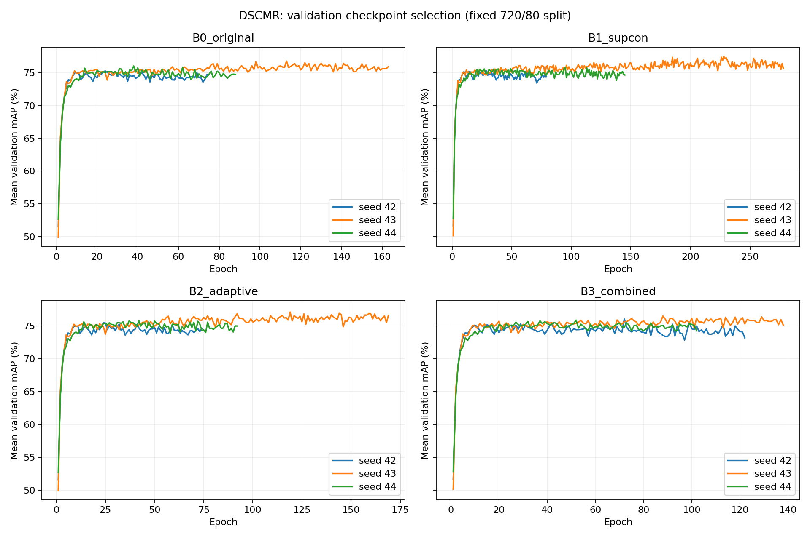
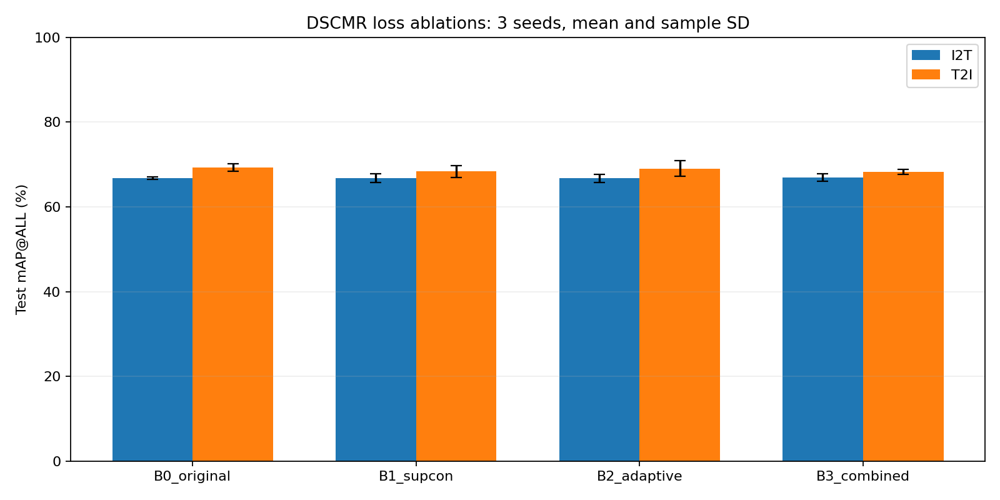

# Kết quả Assignment 3 — DSCMR

Đã hoàn tất 4 lượt kiểm tra × 10 epoch, 4 lượt chạy thử × 200 epoch và 12 lượt chạy chính (4 cấu hình × 3 seed).
Chạy chính tối đa 500 epoch/lượt, early stopping 50 epoch; lấy checkpoint có mAP validation trung bình hai chiều cao nhất. Không refit.

## Kết quả test

Giá trị: phần trăm, trung bình ± độ lệch chuẩn mẫu qua 3 seed huấn luyện.

| Cấu hình | I2T mAP@ALL | T2I mAP@ALL |
|---|---:|---:|
| DSCMR gốc | 66.77 ± 0.30 | 69.32 ± 0.88 |
| + Contrastive | 66.76 ± 1.03 | 68.35 ± 1.40 |
| + Trọng số thích nghi | 66.72 ± 0.92 | 69.04 ± 1.88 |
| + Cả hai | 66.92 ± 0.86 | 68.31 ± 0.61 |

Các chỉ số R@1/R@5/R@10 hai chiều nằm trong results.csv và REPORT.md.

## Epoch thực tế

| Cấu hình | Seed | Epoch đã chạy | Epoch checkpoint tốt nhất |
|---|---:|---:|---:|
| DSCMR gốc | 42 | 74 | 24 |
| + Contrastive | 42 | 79 | 29 |
| + Trọng số thích nghi | 42 | 74 | 24 |
| + Cả hai | 42 | 122 | 72 |
| DSCMR gốc | 43 | 163 | 113 |
| + Contrastive | 43 | 278 | 228 |
| + Trọng số thích nghi | 43 | 169 | 119 |
| + Cả hai | 43 | 138 | 88 |
| DSCMR gốc | 44 | 88 | 38 |
| + Contrastive | 44 | 145 | 95 |
| + Trọng số thích nghi | 44 | 92 | 42 |
| + Cả hai | 44 | 102 | 52 |

Tổng epoch chạy chính: 1524. Tổng thời gian trong các vòng huấn luyện: 7.47 phút (không gồm thời gian triển khai, khởi tạo môi trường và kiểm tra).

## Phạm vi kết luận

- Dữ liệu: đặc trưng tác giả, 720 train / 80 validation / 100 test; cùng split, kiến trúc và batch giữa bốn cấu hình.
- R@K là tỷ lệ truy vấn tìm được ít nhất một kết quả cùng lớp trong top K, không phải tỷ lệ tất cả tài liệu liên quan được thu hồi.
- Đây là thí nghiệm đối chứng với siêu tham số cố định, chưa tuning trọng số baseline hoặc temperature. Không tuyên bố tốt hơn một baseline đã tuning.
- Trọng số thích nghi là quy tắc dựa trên tỷ lệ loss EMA có giới hạn; không phải GradNorm. Tính mới chưa được chứng minh.
- Ba seed không phải ba fold. Chênh lệch nhỏ cần thêm kiểm chứng; không suy ra ý nghĩa thống kê chỉ từ bảng trung bình.
- Dùng checkpoint validation, khác các báo cáo refit cũ; không đối chiếu trực tiếp như cùng protocol. Không chạy lại CLIP4CMR.
- Tập test đã từng được dùng trong lịch sử; lượt này không dùng test để chọn checkpoint hay điều chỉnh cấu hình.

## Kiểm tra

audit.json xác nhận ngân sách, early stopping, checkpoint, split, dữ liệu/mã nguồn gốc không đổi và tính nhất quán giai đoạn warmup.

Kiểm tra độc lập (30/10/2026, `scripts/recheck_assignment3_author_eval.py`): nạp `best.pt` của 12 lượt bằng lớp mô hình gốc, tính mAP test bằng `fx_calc_map_label` của tác giả. Sai khác lớn nhất so với results.csv: 2.2e-16. Epoch trong `best.pt` trùng epoch có mAP validation trung bình cao nhất trong history.json ở cả 12 lượt.

## So sánh theo cặp seed (chênh lệch so với DSCMR gốc, điểm %)

Cùng seed nghĩa là cùng khởi tạo và cùng thứ tự batch, nên so theo cặp chặt hơn so trung bình.

| Cấu hình | Chiều | Seed 42 | Seed 43 | Seed 44 | Số seed tăng |
|---|---|---:|---:|---:|---:|
| + Contrastive | I2T | +0.78 | −0.66 | −0.16 | 1/3 |
| + Contrastive | T2I | −0.09 | −1.56 | −1.29 | 0/3 |
| + Trọng số thích nghi | I2T | −0.28 | −0.73 | +0.86 | 1/3 |
| + Trọng số thích nghi | T2I | +0.06 | −1.41 | +0.50 | 2/3 |
| + Cả hai | I2T | −0.15 | −0.44 | +1.03 | 1/3 |
| + Cả hai | T2I | −1.79 | −0.19 | −1.07 | 0/3 |

## Kết luận

- Với hệ số cố định (1, 0.001, 0.1) và temperature 0.1, **không cấu hình cải tiến nào tốt hơn DSCMR gốc một cách nhất quán**. Chênh lệch trung bình I2T nằm trong khoảng ±0.2 điểm, nhỏ hơn độ lệch giữa các seed.
- Supervised contrastive có xu hướng **giảm T2I** (giảm ở cả 3 seed, trung bình −0.97 điểm); bản kết hợp cũng giảm T2I ở cả 3 seed.
- Trọng số thích nghi gần như trung tính: kết quả dao động quanh baseline theo seed.
- Contrastive làm điểm dừng sớm muộn hơn (checkpoint epoch 29/228/95 so với 24/113/38), tức hội tụ chậm hơn nhưng không cho mAP test cao hơn.
- Đây là kết quả âm tính có kiểm soát, vẫn dùng được cho báo cáo dưới dạng ablation. Muốn có cải tiến dương, bước kế tiếp là tuning hệ số loss và temperature trên validation (cùng ngân sách cho baseline), không dùng test.

