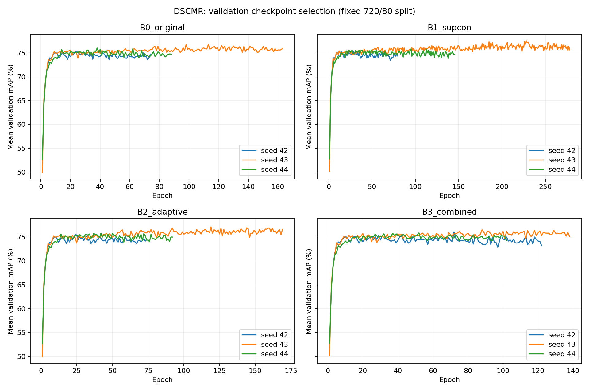
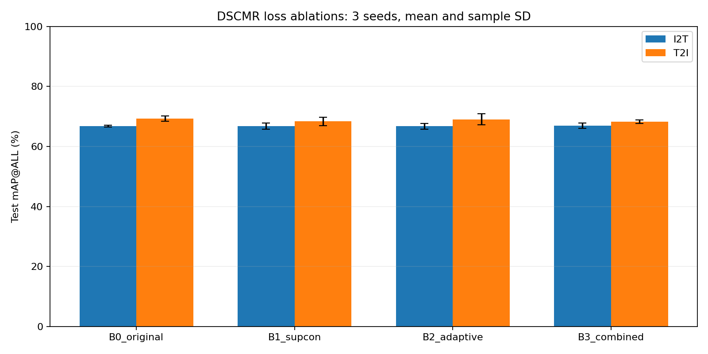

# Kết quả Assignment 3 — DSCMR

Đã hoàn tất 4 lượt kiểm tra × 10 epoch, 4 lượt chạy thử × 200 epoch và 12 lượt chạy chính (4 cấu hình × 3 seed).
Chạy chính tối đa 500 epoch/lượt, early stopping 50 epoch; lấy checkpoint có mAP validation trung bình hai chiều cao nhất. Không refit.

## Kết quả test

Giá trị: phần trăm, trung bình ± độ lệch chuẩn mẫu qua 3 seed huấn luyện.

| Cấu hình | I2T mAP@ALL | T2I mAP@ALL |
|---|---:|---:|
| DSCMR gốc | 66.77 ± 0.30 | 69.32 ± 0.88 |
| + Contrastive | 66.76 ± 1.03 | 68.35 ± 1.40 |
| + Trọng số thích nghi | 66.72 ± 0.92 | 69.04 ± 1.88 |
| + Cả hai | 66.92 ± 0.86 | 68.31 ± 0.61 |

Các chỉ số R@1/R@5/R@10 hai chiều nằm trong results.csv và REPORT.md.

## Epoch thực tế

| Cấu hình | Seed | Epoch đã chạy | Epoch checkpoint tốt nhất |
|---|---:|---:|---:|
| DSCMR gốc | 42 | 74 | 24 |
| + Contrastive | 42 | 79 | 29 |
| + Trọng số thích nghi | 42 | 74 | 24 |
| + Cả hai | 42 | 122 | 72 |
| DSCMR gốc | 43 | 163 | 113 |
| + Contrastive | 43 | 278 | 228 |
| + Trọng số thích nghi | 43 | 169 | 119 |
| + Cả hai | 43 | 138 | 88 |
| DSCMR gốc | 44 | 88 | 38 |
| + Contrastive | 44 | 145 | 95 |
| + Trọng số thích nghi | 44 | 92 | 42 |
| + Cả hai | 44 | 102 | 52 |

Tổng epoch chạy chính: 1524. Tổng thời gian trong các vòng huấn luyện: 7.47 phút (không gồm thời gian triển khai, khởi tạo môi trường và kiểm tra).

## Phạm vi kết luận

- Dữ liệu: đặc trưng tác giả, 720 train / 80 validation / 100 test; cùng split, kiến trúc và batch giữa bốn cấu hình.
- R@K là tỷ lệ truy vấn tìm được ít nhất một kết quả cùng lớp trong top K, không phải tỷ lệ tất cả tài liệu liên quan được thu hồi.
- Đây là thí nghiệm đối chứng với siêu tham số cố định, chưa tuning trọng số baseline hoặc temperature. Không tuyên bố tốt hơn một baseline đã tuning.
- Trọng số thích nghi là quy tắc dựa trên tỷ lệ loss EMA có giới hạn; không phải GradNorm. Tính mới chưa được chứng minh.
- Ba seed không phải ba fold. Chênh lệch nhỏ cần thêm kiểm chứng; không suy ra ý nghĩa thống kê chỉ từ bảng trung bình.
- Dùng checkpoint validation, khác các báo cáo refit cũ; không đối chiếu trực tiếp như cùng protocol. Không chạy lại CLIP4CMR.
- Tập test đã từng được dùng trong lịch sử; lượt này không dùng test để chọn checkpoint hay điều chỉnh cấu hình.

## Kiểm tra

audit.json xác nhận ngân sách, early stopping, checkpoint, split, dữ liệu/mã nguồn gốc không đổi và tính nhất quán giai đoạn warmup.

