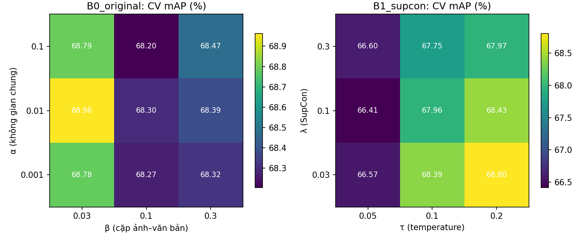
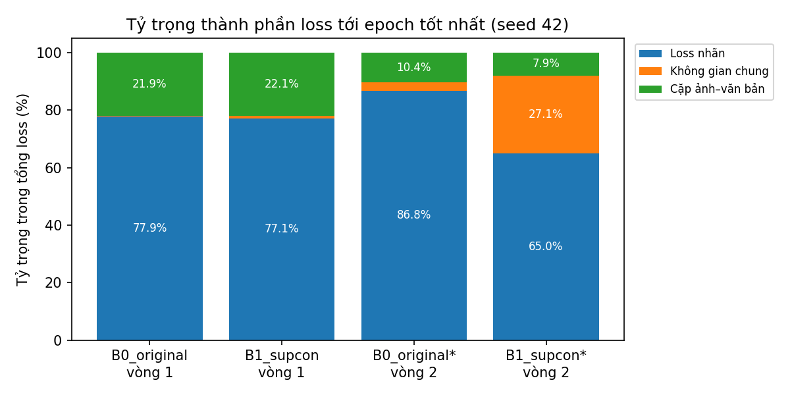
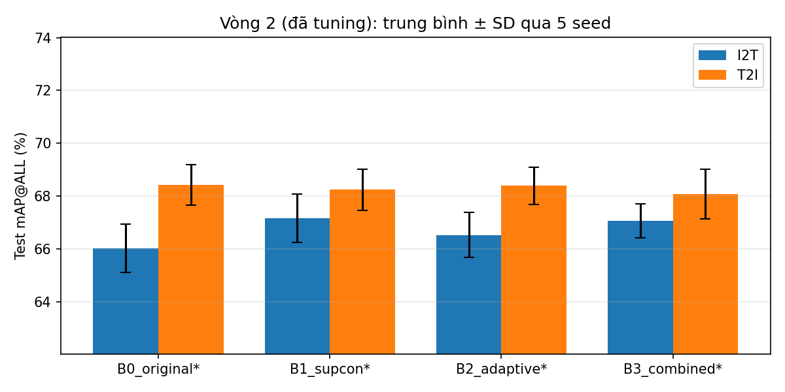

# Assignment 3 — DSCMR vòng 2: tuning hệ số loss + xác nhận 5 seed

Ngày chạy: 30/10/2026. Bảng số liệu đầy đủ (tuning 18 cấu hình, R@K, chênh lệch theo seed) nằm trong [REPORT.md](REPORT.md); file này tóm tắt và kết luận.

## Vì sao có vòng 2

Ở vòng 1, hệ số của loss không gian chung là 0.001, nên thành phần này chỉ chiếm khoảng 0.3–1% tổng loss. Thay nó bằng SupCon hay điều chỉnh trọng số của nó vì thế gần như không ảnh hưởng đến huấn luyện. Vòng 2 tuning hệ số với ngân sách bằng nhau cho bản gốc và bản cải tiến, rồi chạy xác nhận bằng nhiều seed hơn.

## Quy trình

1. **Tuning** bằng 3-fold CV phân tầng trên 800 mẫu train (seed 42), không dùng test.
   - B0 (loss gốc): α ∈ {0.001, 0.01, 0.1} × β ∈ {0.03, 0.1, 0.3}, tổng 9 cấu hình.
   - B1 (SupCon): λ ∈ {0.03, 0.1, 0.3} × τ ∈ {0.05, 0.1, 0.2}, tổng 9 cấu hình; β lấy theo B0 tốt nhất.
   - Mỗi lần chạy tối đa 300 epoch, dừng sớm sau 50 epoch không cải thiện. Tổng cộng 54 lần chạy.
2. **Cấu hình được chọn:**
   - B0\* = (1, 0.01, 0.03).
   - B1\* = (1, 0.03, 0.03), τ = 0.2.
   - B2\* = B0\* + trọng số thích nghi; B3\* = B1\* + trọng số thích nghi (hai cấu hình này không tuning thêm).
3. **Xác nhận:** 4 cấu hình × 5 seed (42–46), dùng split 720/80 của vòng 1, tối đa 500 epoch, dừng sớm sau 50 epoch. Checkpoint chọn theo validation. Test 100 cặp chỉ được mở sau khi cả 20 lượt đã chạy xong.

## Kết quả test (mAP@ALL %, trung bình ± SD qua 5 seed)

| Cấu hình | I2T | T2I | Trung bình 2 chiều |
|---|---:|---:|---:|
| B0\* gốc, đã tuning | 66.02 ± 0.91 | 68.42 ± 0.76 | 67.22 |
| B1\* + SupCon | **67.17 ± 0.92** | 68.24 ± 0.78 | **67.71** |
| B2\* + trọng số thích nghi | 66.52 ± 0.86 | 68.40 ± 0.71 | 67.46 |
| B3\* + cả hai | 67.06 ± 0.64 | 68.07 ± 0.94 | 67.57 |
| *Tham chiếu: B0 hệ số mặc định (vòng 1, 3 seed)* | *66.77 ± 0.30* | *69.32 ± 0.88* | *68.05* |

**So với B0\*, theo cặp seed (cùng khởi tạo, cùng thứ tự batch):**

| Cấu hình | I2T: trung bình (số seed tăng) | T2I: trung bình (số seed tăng) |
|---|---:|---:|
| B1\* SupCon | **+1.15 (5/5)** | −0.18 (1/5) |
| B2\* thích nghi | +0.50 (4/5) | −0.02 (2/5) |
| B3\* cả hai | **+1.04 (5/5)** | −0.35 (3/5) |

**So với B0 hệ số mặc định (vòng 1), chỉ seed 42–44 vì vòng 1 chỉ chạy 3 seed; cùng split, cùng thứ tự batch:**

| Cấu hình | I2T: chênh lệch từng seed | T2I: chênh lệch từng seed |
|---|---|---|
| B0\* | −0.47 / −1.23 / +0.55 | −1.17 / −0.75 / −0.92 |
| B1\* | +0.04 / +0.65 / +1.94 | −1.68 / +0.43 / −0.92 |
| B3\* | +0.40 / +0.36 / +0.62 | −0.99 / −0.51 / −0.75 |

## Kết luận

1. **Sau khi tăng hệ số, SupCon có tác động thực sự.** Phần đóng góp của loss không gian chung tăng từ khoảng 1% lên khoảng 27% tổng loss (xem `loss_share.png`).
2. **SupCon cải thiện chiều ảnh → văn bản một cách nhất quán:** tăng ở 5/5 seed so với B0\* (trung bình +1.15 điểm), và ở 3/3 seed so với B0 hệ số mặc định.
3. **Chiều văn bản → ảnh không cải thiện.** So với B0\*, kết quả gần như không đổi. So với B0 hệ số mặc định thì thấp hơn khoảng 0.7 điểm. Tính trung bình cả hai chiều, **B0 hệ số mặc định vẫn cao nhất (68.05)**.
4. **Tuning hệ số cho B0 không giúp được trên test.** Các cấu hình B0 chỉ chênh nhau 0.8 điểm trên CV, trong khi độ lệch chuẩn giữa các fold khoảng 1.1–1.6 điểm. Nghĩa là tuning trên 800 mẫu không phân biệt được các cấu hình B0. Cấu hình được chọn (β = 0.03) còn làm T2I giảm khoảng 0.9 điểm so với mặc định.
5. **Trọng số thích nghi gần như trung tính** ở cả hai vòng, nên không nên trình bày như một đóng góp chính.
6. **Về τ:** SupCon nhạy với temperature. τ = 0.05 kém hơn khoảng 2 điểm trên CV. τ = 0.2 là giá trị tốt nhất nhưng nằm ở biên của lưới, nên τ tối ưu có thể lớn hơn. Đây là hướng có thể thử tiếp, chỉ dùng validation.

**Cách trình bày gợi ý cho Assignment 3:** *“Thay loss không gian chung bằng supervised contrastive (đặt đủ trọng số) cải thiện I2T ổn định khoảng +1 điểm mAP trên Pascal Sentence, nhưng không cải thiện T2I. Ngoài ra, hệ số mặc định 0.001 của DSCMR khiến loss này gần như không tác động đến quá trình học.”* Cách viết này là kết quả trung thực, có ablation và có chẩn đoán; không nên viết là “vượt DSCMR” một cách tổng quát.

## Phạm vi và hạn chế

- Test chỉ có 100 cặp, nên chênh lệch khoảng 1 điểm vẫn có thể bị nhiễu ảnh hưởng. Kết quả 5/5 seed cho thấy xu hướng, nhưng không thay được kiểm định thống kê trên nhiều tập dữ liệu.
- So sánh với B0 mặc định chỉ dùng 3 seed, và B0 mặc định không trải qua cùng quy trình tuning.
- Tập test đã được xem ở các lần chạy trước. Lần chạy này không dùng test để chọn cấu hình hay checkpoint.
- Trọng số thích nghi là quy tắc EMA có giới hạn, không phải GradNorm. SupCon đa positive là kỹ thuật đã có (Khosla et al., 2020); đóng góp ở đây là áp dụng và phân tích cho DSCMR, không phải một loss mới.

## Kiểm tra

- `verification.json`: self-test vòng 1 đạt (loss và gradient khớp mã tác giả, SupCon khớp phép tính brute-force).
- **Tái lập vòng 1:** với hệ số gốc, runner mới cho lại đúng history 15 epoch của B0 và B3 seed 42 vòng 1 (sai khác 0).
- **Kiểm tra độc lập** bằng `scripts/dscmr/recheck_author_eval.py`, dùng `fx_calc_map_label` của tác giả: sai khác tối đa so với results.csv là 2.2e-16. Checkpoint đúng epoch tốt nhất trên validation ở cả 20 lượt.
- **Sự cố:** lần chạy đầu bị dừng vì OneDrive khóa `status.json` khi ghi. Đã thêm cơ chế thử lại khi ghi file và chạy lại toàn bộ trong thư mục sạch. Không có kết quả nào lấy từ lần chạy lỗi.

Lưu ý: trục y của `test_map_tuned.png` bắt đầu từ khoảng 62% để thấy rõ chênh lệch; không đọc chiều cao cột như tỷ lệ tuyệt đối.
