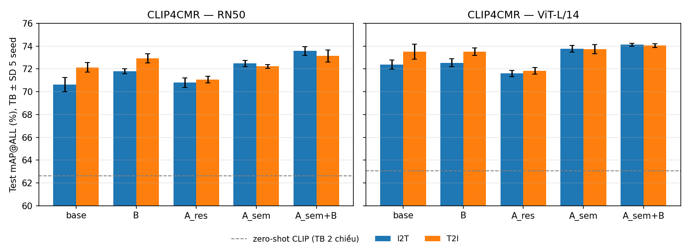

# Cải tiến CLIP4CMR: prototype ngữ nghĩa (A), từng caption (B), backbone (D)

> **Cập nhật:** đã chạy lại trên split của tác giả (lấy từ bản sao dữ liệu gốc). Trên RN50 cải tiến vẫn ổn định (+2.58); trên ViT-L/14 chỉ còn +0.30, không đáng kể. Xem [SO_SANH_BAI_BAO_20261030.md](../SO_SANH_BAI_BAO_20261030.md).

Ngày chạy: 30/10/2026. Bảng đầy đủ (tuning α, R@K, chênh lệch theo seed): [REPORT.md](REPORT.md). Số liệu thô: `results.csv`, `aggregate.json`.

## Hai điểm yếu trong CLIP4CMR gốc

1. **Tâm lớp (prototype) là vector ngẫu nhiên cố định**: khởi tạo Kaiming, `requires_grad=False`, không bao giờ được học. Các lớp gần nghĩa như mèo/chó hay xe buýt/ô tô cách nhau ngẫu nhiên. Đầu ra MLP cũng bị đưa sang một không gian mới, làm mất tri thức sẵn có của CLIP.
2. **Văn bản bị cắt.** 5 caption của mỗi ảnh được nối lại rồi cắt ở 77 token, nên các caption cuối thường bị bỏ.

## Phương pháp

- **A — Adapter phần dư + prototype ngữ nghĩa.**
  - Đầu ra `f = l2norm((1−α)·l2norm(x) + α·l2norm(MLP(x)))` vẫn nằm trong không gian CLIP. MLP giữ nguyên kiến trúc gốc của CLIP4CMR.
  - Prototype của mỗi lớp là embedding văn bản CLIP của câu "a photo of a {lớp}.", cố định.
  - α ∈ {0.1, 0.3, 0.5} được chọn bằng 3-fold CV trên 800 mẫu train; kết quả α = 0.3 cho cả hai backbone.
  - **A_res** là cấu hình đối chứng: dùng adapter phần dư nhưng giữ prototype ngẫu nhiên như bản gốc.
- **B — Mã hóa từng caption.**
  - Khi huấn luyện, mỗi epoch chọn ngẫu nhiên 1 caption cho mỗi ảnh (tăng dữ liệu văn bản).
  - Khi đánh giá, văn bản là trung bình embedding các caption, không cắt 77 token.
- **D — Backbone.** CLIP RN50 (giống bản gốc) so với CLIP ViT-L/14, cả hai đều đóng băng.
- **Giữ nguyên so với bản gốc:** loss PAN, Adam lr 1e-4, batch 300, khoảng cách euclidean.
  - Base RN50 tái tạo đúng từng số lịch sử validation của lượt CLIP4CMR cũ.
- **Quy trình:**
  - Mỗi cấu hình chạy 5 seed (42–46). Checkpoint chọn theo validation 720/80, tối đa 500 epoch, dừng sớm sau 50 epoch không cải thiện.
  - Thực tế mỗi lượt dừng ở khoảng 120–210 epoch.
  - Test 200 cặp chỉ được mở một lần, sau khi cả 50 lượt đã chạy xong.

## Kết quả test (mAP@ALL %, trung bình ± SD qua 5 seed)

| Backbone | Cấu hình | I2T | T2I | TB 2 chiều |
|---|---|---:|---:|---:|
| RN50 | zero-shot CLIP, trung bình caption (không huấn luyện) | 64.01 | 61.27 | 62.64 |
| RN50 | base (CLIP4CMR gốc) | 70.63 ± 0.62 | 72.14 ± 0.41 | 71.39 |
| RN50 | + B | 71.81 ± 0.22 | 72.94 ± 0.40 | 72.38 |
| RN50 | + A_res (đối chứng) | 70.79 ± 0.43 | 71.07 ± 0.29 | 70.93 |
| RN50 | + A_sem | 72.48 ± 0.27 | 72.22 ± 0.17 | 72.35 |
| RN50 | **+ A_sem + B** | **73.57 ± 0.38** | **73.14 ± 0.52** | **73.35** |
| ViT-L/14 | zero-shot CLIP, trung bình caption | 64.11 | 62.04 | 63.08 |
| ViT-L/14 | base | 72.40 ± 0.40 | 73.52 ± 0.65 | 72.96 |
| ViT-L/14 | + B | 72.55 ± 0.34 | 73.52 ± 0.34 | 73.03 |
| ViT-L/14 | + A_res (đối chứng) | 71.60 ± 0.28 | 71.83 ± 0.29 | 71.71 |
| ViT-L/14 | + A_sem | 73.78 ± 0.29 | 73.73 ± 0.39 | 73.76 |
| ViT-L/14 | **+ A_sem + B** | **74.13 ± 0.12** | **74.05 ± 0.16** | **74.09** |

**So với base cùng backbone, theo cặp seed (trung bình, số seed tăng):**

| Backbone | Cấu hình | I2T | T2I |
|---|---|---:|---:|
| RN50 | B | +1.18 (5/5) | +0.80 (5/5) |
| RN50 | A_sem | +1.85 (5/5) | +0.08 (3/5) |
| RN50 | **A_sem + B** | **+2.94 (5/5)** | **+1.00 (5/5)** |
| ViT-L/14 | B | +0.15 (3/5) | −0.00 (2/5) |
| ViT-L/14 | A_sem | +1.38 (5/5) | +0.21 (3/5) |
| ViT-L/14 | **A_sem + B** | **+1.73 (5/5)** | **+0.52 (4/5)** |
| RN50 | A_res (đối chứng) | +0.16 (3/5) | −1.07 (0/5) |
| ViT-L/14 | A_res (đối chứng) | −0.80 (0/5) | −1.69 (0/5) |



## Kết luận

1. **A_sem + B cải thiện CLIP4CMR ổn định trên cả hai backbone.**
   - RN50: tăng ở 5/5 seed cho cả hai chiều. Trung bình hai chiều +1.97 điểm (71.39 → 73.35), riêng I2T +2.94.
   - ViT-L/14: trung bình hai chiều +1.13 điểm; I2T tăng 5/5 seed, T2I tăng 4/5 seed.
2. **Tác dụng của A đến từ prototype ngữ nghĩa, không đến từ adapter phần dư.** A_res (adapter phần dư + prototype ngẫu nhiên) còn làm giảm T2I ở cả 10/10 lượt. Chỉ khi thay prototype bằng embedding của tên lớp thì kết quả mới tăng. Đây là ablation quan trọng nhất cho paper.
3. **B có ích rõ trên RN50 (5/5 seed cả hai chiều), nhưng gần như trung tính trên ViT-L/14 khi dùng một mình.** Kết hợp với A thì vẫn cộng thêm được trên cả hai backbone.
4. **Backbone (D) giúp ít hơn dự đoán.** ViT-L/14 chỉ hơn RN50 khoảng +1.4–1.8 điểm ở base, và khoảng +0.6–0.9 sau khi đã có A + B. Dự đoán ban đầu của tôi là +3–8 điểm, nên đã sai.
5. **Phương pháp đáng giá hơn đổi backbone:** RN50 + A_sem + B (73.35) **cao hơn ViT-L/14 base (72.96)**, dù ViT-L/14 là encoder lớn hơn nhiều. Tính theo cặp seed: I2T +1.17 (5/5), T2I −0.39 (1/5).
6. **Mọi cấu hình đã huấn luyện đều vượt xa zero-shot CLIP** (khoảng +8–11 điểm), nên phần huấn luyện có giá trị thật.

**Gợi ý câu kết luận cho paper:** *"Thay prototype ngẫu nhiên của CLIP4CMR bằng prototype ngữ nghĩa từ bộ mã hóa văn bản CLIP, kết hợp mã hóa từng caption, tăng mAP trung bình khoảng +2 điểm (RN50) và +1.1 điểm (ViT-L/14), ổn định qua 5 seed. Ablation cho thấy lợi ích đến từ prototype ngữ nghĩa chứ không phải adapter phần dư."*

## Lưu ý khi đọc số liệu

- **R@1 của các cấu hình có A tăng vọt (khoảng 79% lên khoảng 95%)** trong khi mAP chỉ tăng khoảng 1–3 điểm. R@1 ở đây là tỷ lệ truy vấn có kết quả đầu tiên cùng lớp. Giải thích khả dĩ (chưa kiểm chứng riêng): adapter phần dư giữ lại tương đồng cấp mẫu của CLIP, nên cặp ảnh–văn bản tương ứng (vốn cùng lớp) thường đứng đầu danh sách. Base kéo mọi mẫu về tâm lớp nên mất thông tin này. Khi trình bày, nên lấy mAP làm chỉ số chính.
- Split 800/200 là split cục bộ tự tạo từ UIUC, không phải split của bài báo. Không so trực tiếp với số liệu bài báo hay với DSCMR (test 100).
- Base giữ nguyên siêu tham số gốc. Chỉ có α của A được chọn bằng CV (3 giá trị, không dùng test).
- Prototype từ prompt CLIP và adapter phần dư đã có trong các nghiên cứu về CLIP (ví dụ CLIP-Adapter, zero-shot prompt). Đóng góp ở đây là áp dụng vào CLIP4CMR, chỉ ra điểm yếu prototype ngẫu nhiên, và ablation tách riêng từng thành phần.
- Test chỉ có 200 cặp. Kết quả 5/5 seed cho thấy xu hướng nhất quán, nhưng không thay được kiểm định trên nhiều tập dữ liệu (ví dụ Wikipedia, NUS-WIDE).

## Kiểm tra

- Đặc trưng RN50 trích xuất lại trùng tuyệt đối với file `clip_*.pkl` cũ. Đặc trưng ViT-L/14 lấy từ checkpoint chính thức; thư viện `clip` đã kiểm tra SHA-256 khi tải.
- Base RN50 seed 42 tái tạo đúng từng số loss và mAP validation của lượt CLIP4CMR cũ. Checkpoint tốt nhất ở epoch 69, trùng với lượt cũ chạy 5.000 epoch.
- `scripts/recheck_clip4cmr_improve.py` nạp lại 50 checkpoint và tính mAP bằng `fx_calc_map_label` gốc của CLIP4CMR. Sai khác tối đa so với results.csv: 2.2e-16. Epoch trong `best.pt` đúng là epoch có mAP validation tốt nhất ở cả 50/50 lượt.

## Tái lập

```
.venv310\Scripts\python.exe scripts\build_clip4cmr_multicaption.py
.venv310\Scripts\python.exe scripts\clip4cmr_improve.py --stage all
.venv310\Scripts\python.exe scripts\recheck_clip4cmr_improve.py
<python có matplotlib> scripts\plot_clip4cmr_improve.py
```
